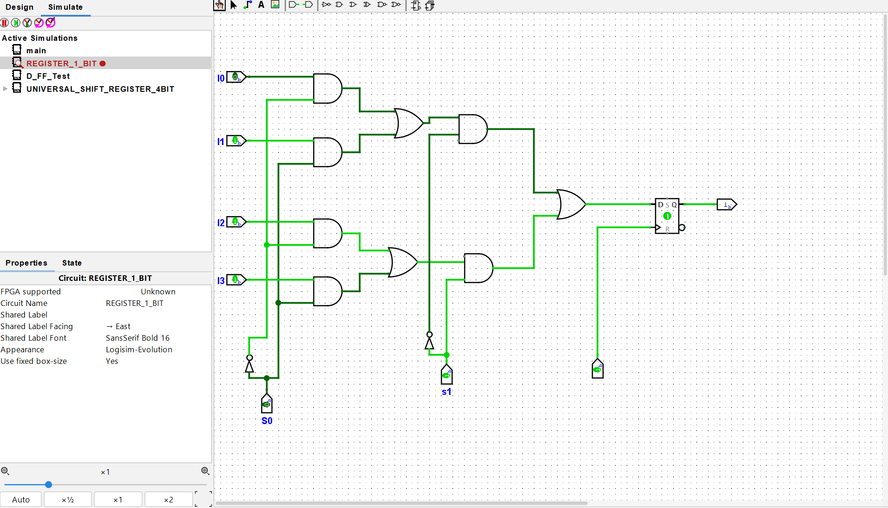
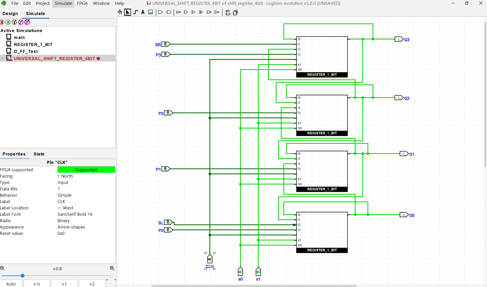

# 74LS194 Universal Shift Register and Digital Logic Mini Projects

A set of Logisim Evolution circuits for exploring mux selection, one-bit storage, and a 4-bit universal shift register. The project includes the 4:1 mux and register schematics, a D flip-flop test circuit, and the assembled shift register.

## Circuits

- `MUX2.1.circ` — 2:1 mux circuit.
- `MUX24.circ` — mux and register project, including `REGISTER_1_BIT`, `D_FF_Test`, and `UNIVERSAL_SHIFT_REGISTER_4BIT` circuits.
- `shift_register_4bit.circ` — 4-bit universal shift-register project with its one-bit register and D flip-flop test circuits.

The universal shift register has parallel inputs `P0`–`P3`, serial inputs `SL` and `SR`, a shared clock, and outputs `Q0`–`Q3`. Its mode controls are `S1` and `S0`:

| `S1` | `S0` | Operation |
|:---:|:---:|---|
| 0 | 0 | Hold current value |
| 0 | 1 | Shift right |
| 1 | 0 | Shift left |
| 1 | 1 | Parallel load |

## Screenshots

### Mux and one-bit register

### 4-bit universal shift register

## Open the circuits

Open any `.circ` file in [Logisim Evolution](https://github.com/logisim-evolution/). The files use Logisim Evolution 5.0.0 format. `MUX24.circ` and `shift_register_4bit.circ` contain the named subcircuits listed above.

## Implementation note

The supplied `.circ` files are Logisim logic diagrams. They show standard gate and register components, and do not include a MOSFET-level transistor schematic for the mux or a NAND-and-inverter schematic for the master–slave D flip-flop. Add those transistor-level schematics separately if you want this repository to document those implementations specifically.
